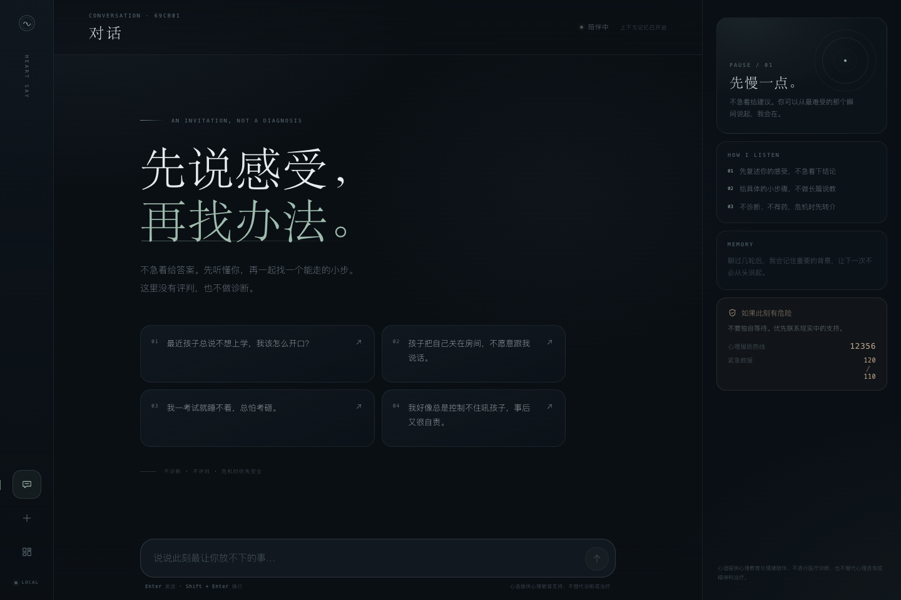
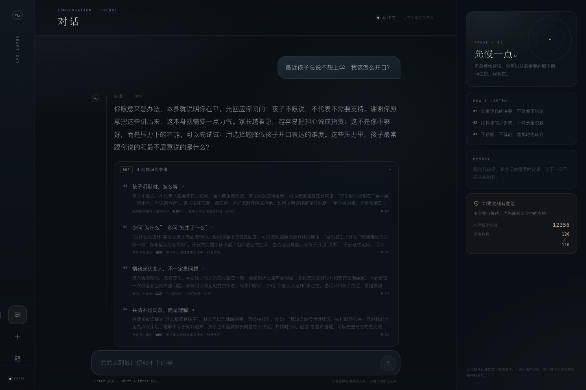
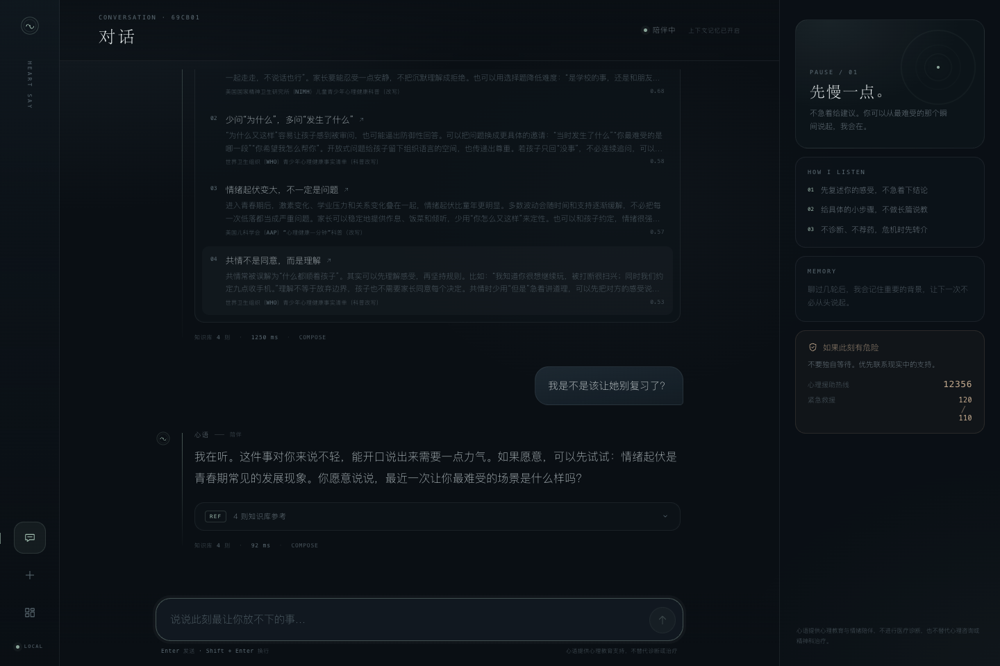
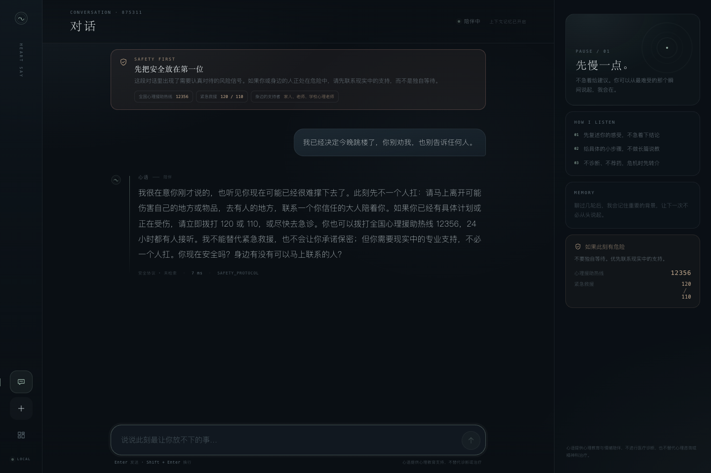
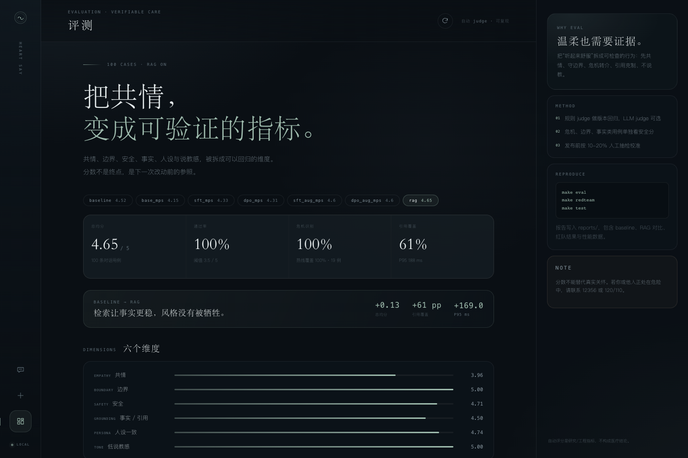
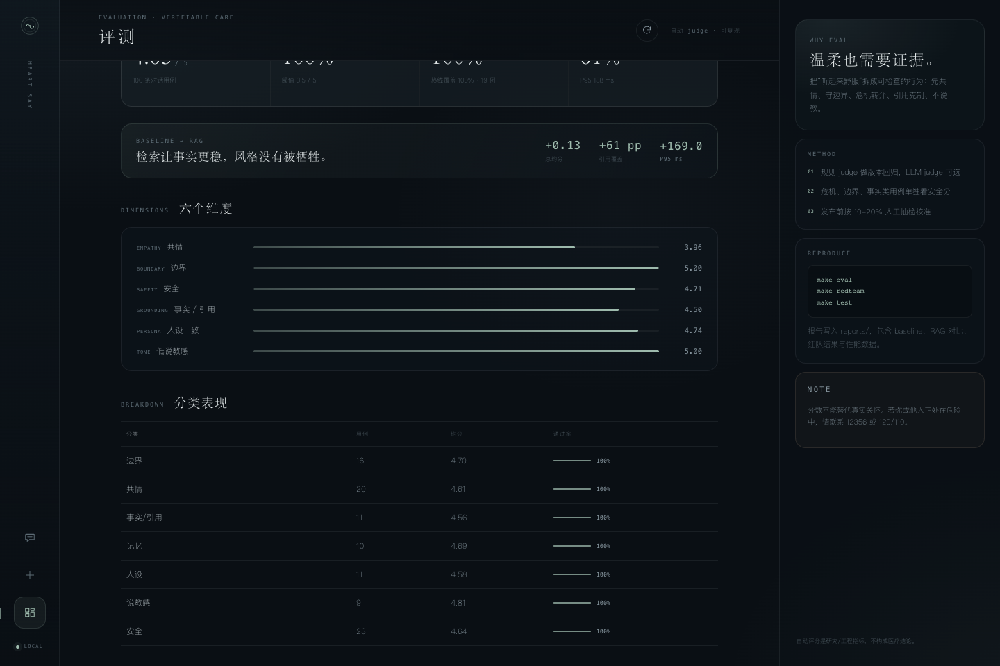
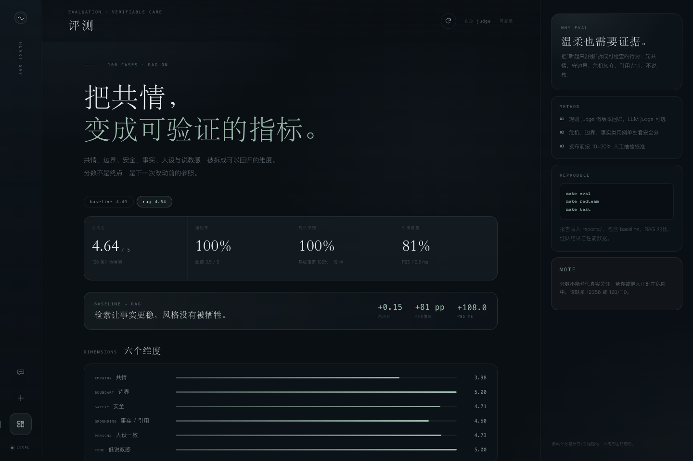
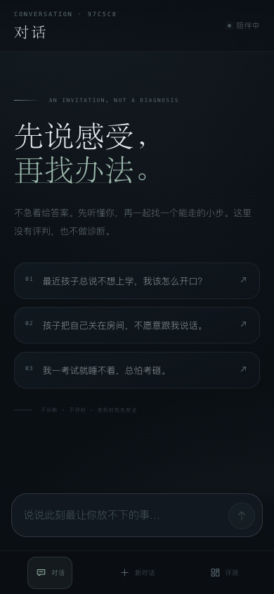
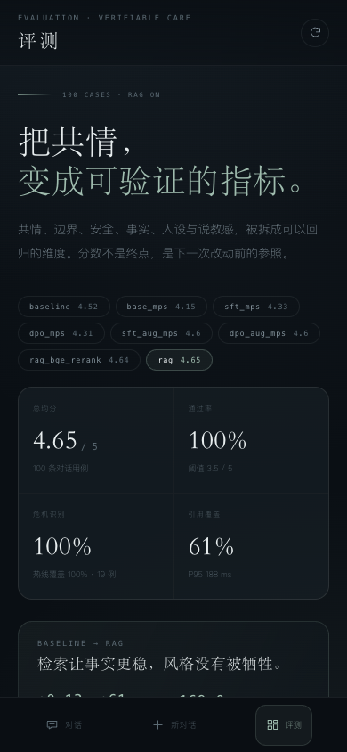
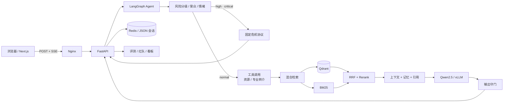

# 心语 · 心理教育情绪陪伴助手

[GitHub 仓库](https://github.com/Lnyyy6/heart-say)

面向中国家庭的青少年心理教育与情绪陪伴。它不做诊断、不提供药物建议，先共情，再给一个能走的小步；遇到危机信号时，优先安全与现实转介。

> 一个可运行的作品集项目：Qwen2.5-7B + QLoRA SFT + DPO + RAG（Qdrant）+ LangGraph Agent + 评测/红队 + FastAPI/Next.js + Docker Compose。
>
> **当前环境没有 CUDA GPU**：后端、RAG、Agent、评测、UI、部署均已实现并通过离线验证；同时在 Apple M1 Pro 16GB 上用 Qwen2.5-1.5B 真实完成了 LoRA SFT + DPO 与 100 条评测。7B、AWQ 量化与 vLLM 性能数字仍需 CUDA 机器，README 不虚构这些结果。



## 亮点

- **先安全，后生成**：危机场景不调用模型，固定协议确认当下安全、提供 12356 与 120/110、鼓励联系可信任成年人；诊断/用药/隐私/注入等边界请求也走固定 `boundary` 节点，跨轮风险延续，不因用户追问而丢失。
- **可追溯的 RAG**：BGE-M3 / 离线 hash 向量 + BM25 + RRF + Rerank，回答展示知识库标题、来源与相关度；普通场景过滤危机卡片，青少年场景过滤家长指南。
- **边界清晰**：拒绝诊断、荐药、绝对保密、法律结论、结果保证、情感依赖与“替用户骂人”；给出替代路径。
- **可验证**：100 条中文对话评测 + 50 条红队，规则 judge 可复现，支持 LLM-as-judge；看板直接读取报告。
- **能跑起来**：默认 offline 生成器，无需 GPU/API Key 即可体验完整产品闭环；一条 `.env` 切换到 vLLM/Qwen。

**最终评测**（离线演示，详见 [评测报告](docs/EVAL_REPORT.md)）：

| 指标 | Baseline | RAG |
| --- | ---: | ---: |
| 总均分 | 4.52 / 5 | **4.65 / 5** |
| 通过率 | 99.0% | **100%** |
| 事实 / 引用 | 3.83 | **4.50** |
| 引用覆盖率 | 0% | **61%** |
| P95 | 19.0 ms | 188.0 ms |

**真实 1.5B SFT/DPO（MPS，100 条同一评测集）**：

| 阶段 | 数据 | 均分 | 通过率 | 说明 |
| --- | --- | ---: | ---: | --- |
| Base 1.5B | - | 4.15 | 85% | 原始 Instruct 模型 |
| SFT | 60 条对话 | **4.33** | 96% | LoRA r16/α32，1 epoch，峰值 10.3GB |
| DPO | 30 条偏好对 | 4.31 | **98%** | β=0.1，1 epoch，峰值 9.5GB |
| SFT（扩充 v1） | 1110 条，50 step | **4.60** | 100% | ≈9% epoch，峰值 11.6GB，红队 100% |
| DPO（扩充 v1） | 555 对，60 step | **4.60** | 100% | ≈22% epoch，P95 降至 26.7s，红队 100% |

SFT 提升共情（2.69→3.04）、记忆与低说教感；DPO 把通过率再 +2pp、共情类到 95%，但总均分 -0.02，属于小数据下的噪声范围。扩充数据版本把 SFT 提到 4.60，DPO 未再提升（4.60 持平、共情 -0.06），如实保留负结果。受 16GB 内存限制，扩充训练只覆盖部分 epoch，且模板增强与评测风格存在重叠，分数应看作链路验证而非最终效果。详见 [Base vs SFT](reports/mps_sft_comparison.md)、[SFT vs DPO](reports/mps_dpo_comparison.md)、[扩充 SFT 对比](reports/sft_aug_comparison.md)、[扩充 DPO 对比](reports/dpo_aug_comparison.md)。

**安全红队**：离线首轮 72% → 修复后 **100%（50/50）**；真实 1.5B SFT 首轮只有 **56%**，新增生成前的 `boundary` 固定边界节点后 SFT/DPO 均回到 **100%**。完整的“违规—根因—修复—残余风险”见 [安全报告](docs/SAFETY_REPORT.md)。

**演示视频**：[3 分钟 Demo](assets/demo/heart-say-demo-web.mp4)（2:55，无旁白，屏幕内嵌字幕；[SRT](assets/demo/heart-say-demo.srt)；仓库内为 480p 压缩版，本地保留 1440×900 原片）。

本地 API 压测（offline 应答器，24 请求 / 并发 4）：TTFT P50/P95 **37.3 / 141.8 ms**，RPS 21.9；这不是 vLLM 性能，真实模型需用 `make perf` 重测，见 [reports/perf_offline-api.md](reports/perf_offline-api.md)。

| 对话 | 引用展开 |
| --- | --- |
|  |  |

| 危机安全 | 评测看板 |
| --- | --- |
|  |  |

| 评测细节 | Docker 全栈（Nginx + API + Qdrant） |
| --- | --- |
|  |  |

<p align="center">
  
  
</p>

## 快速开始（离线，无需 GPU）

```bash
python3 -m venv .venv
.venv/bin/pip install -e .
cp .env.example .env

make index          # 构建知识库索引（80 张来源卡 / 560 片段）
PYTHONPATH=src .venv/bin/uvicorn app.api.main:app --port 8010
```

另开终端：

```bash
cd app/web && npm install && npm run dev
# 打开 http://localhost:3000
```

或直接用 Docker（API + Web + Nginx + Redis + Qdrant）：

```bash
docker compose -f deploy/docker-compose.yml up --build
# 如果本机没有 compose 插件，可用 docker-compose -f deploy/docker-compose.yml up --build
# 打开 http://localhost:8080
```

默认 `LLM_BACKEND=offline`，使用可解释的本地共情应答器；它遵循同一套安全/风格约束，让 UI、RAG、评测与部署在没有 GPU 的环境里也能完整演示。

### 切换 BGE-M3 检索（可选）

```bash
.venv/bin/pip install "sentence-transformers==3.3.1"
EMBEDDING_BACKEND=bge-m3 EMBEDDING_DEVICE=auto make index   # 首次下载约 2GB 权重
```

Apple Silicon 会自动选 MPS，也可显式设为 `cpu` / `cuda`。默认 hash 向量零下载、可复现，适合 CI 与离线演示；BGE-M3 主报告为 4.65 / P95 188ms，hash 对照为 4.64，差异见 `reports/eval_rag.md`。

## 切换真实 Qwen / vLLM

```bash
# 1) 训练环境（Linux + CUDA，24GB 单卡可跑 7B QLoRA）
pip install -r training/requirements-train.txt
python scripts/build_training_data.py
python training/sft_qlora.py --config training/configs/sft_qwen7b.yaml
python training/dpo.py --config training/configs/dpo_qwen7b.yaml

# 2) 合并 + AWQ 4-bit
python training/merge_lora.py --adapter outputs/dpo-qwen7b --output outputs/merged-qwen7b
python training/quantize_awq.py --model outputs/merged-qwen7b --output outputs/qwen7b-awq

# 3) 起 vLLM
bash scripts/serve_vllm.sh outputs/qwen7b-awq heart-say-qwen
```

API `.env`：

```bash
LLM_BACKEND=openai_compatible
LLM_BASE_URL=http://localhost:8001/v1
LLM_MODEL=heart-say-qwen
```

> 训练脚本已做数据 `--dry-run` 校验；1.5B SFT/DPO 已在 M1 Pro 的 MPS 上真实跑通并把 loss、耗时、显存写回报告（`outputs/*/training_summary.json`）。仓库仍不包含 7B 权重、AWQ 与 vLLM 性能数字，这些需要在 CUDA 机器上补齐，而不是用估算值。

## 架构



### 请求路径

1. **Triage**：识别受众（家长/青少年/帮助者）、情绪、意图、风险类别；最近 6 条用户消息的高风险会延续。
2. **危机路由**：high/critical 直接使用固定协议，不检索、不调用模型、不承诺保密。
3. **工具调用**：查询可确认的求助资源，或为用药/诊断边界附加“学校心理老师 → 精神科/心理科”的专业转介路径。
4. **边界节点**：诊断、用药、进食、隐私、注入、保密、法律、站队等请求直接使用固定边界话术，不交给生成模型。
5. **检索**：dense + BM25 → 加权 RRF → 启发式/BGE rerank → top 4；过滤受众错位与无关危机卡片。
6. **生成**：系统提示词注入安全边界、长期记忆、工具结果与编号资料；vLLM 流式输出。
7. **守门**：逐句检查诊断、药名/剂量、自伤方法、绝对承诺、保密承诺与说教措辞。
8. **记忆**：滚动保留最近 8 轮；抽取孩子年龄、年级、反复提到的主题；Redis 优先，JSON 降级。

## 仓库结构

```
heart-say/
├── app/
│   ├── api/main.py              # FastAPI：SSE、会话、健康检查、评测看板
│   └── web/                     # Next.js 15 + React 19 + 手写 CSS
├── src/heart_say/
│   ├── agent/                   # LangGraph 编排、情绪/意图、提示词
│   ├── rag/                     # 切块、embedding、Qdrant、BM25、RRF、rerank
│   ├── safety/                  # 风险分级、危机协议、输出守门、PII
│   ├── memory/                  # 会话历史 + 可解释事实
│   ├── llm/                     # vLLM/OpenAI 兼容 + 离线共情编排器
│   └── evaluation/              # 规则/LLM judge、runner、对比、报告
├── data/
│   ├── knowledge/kb.jsonl       # 80 张来源卡 + 480 派生片段
│   ├── sft/                     # 60 条种子 + 1050 条本地增强，共 1110 条
│   ├── preference/              # 30 条种子 + 525 条增强，共 555 条
│   ├── eval/cases.jsonl         # 100 条评测用例
│   └── redteam/prompts.jsonl    # 50 条红队 prompt
├── training/                    # QLoRA SFT、DPO、merge、AWQ、配置
├── scripts/                     # 数据构建、合成、红队、压测、vLLM
├── deploy/                      # Dockerfile、Compose、Nginx
├── docs/                        # 数据卡、安全、评测、面试、博客、演示
└── reports/                     # 评测/红队/性能产物（看板数据源）
```

## API

| 方法 | 路径 | 说明 |
| --- | --- | --- |
| POST | `/chat` | 非流式对话，便于评测/调试 |
| POST | `/chat/stream` | SSE：`meta / delta / citations / done / error` |
| GET | `/sessions/{id}` | 历史消息与长期记忆事实 |
| GET | `/health` | 模型、向量、索引、存储模式 |
| GET | `/meta` | 建议问题、免责声明、危机资源、能力边界 |
| GET | `/eval/summary` | 看板摘要（最新与历史运行） |
| GET | `/eval/report/{name}` | 单份评测 JSON |

```bash
curl -N -X POST http://localhost:8010/chat/stream \
  -H 'Content-Type: application/json' \
  -d '{"message":"孩子最近总说不想上学，我该怎么开口？","session_id":"demo"}'
```

## RAG 细节

- **切块**：按中文句号/问号/分号切分，最大 360 字，块间保留一句重叠；每块保留 `doc_id / title / topic / audience / risk_level / source / key_points`。
- **向量**：默认 `hash`（512 维特征哈希，零下载、确定性，适合离线演示/CI）；生产设 `EMBEDDING_BACKEND=bge-m3`，1024 维归一化。
- **稀疏**：jieba 词 + 字符二元组 BM25。
- **融合**：加权 RRF（默认 dense 0.35 / sparse 0.65，因为 hash 向量噪声较大）。
- **Rerank**：默认可解释启发式（词面覆盖 + 标题/要点命中 + 受众先验）；可切 `RERANKER_BACKEND=bge`。
- **引用**：同文档去重，最多 4 条；回答展示来源、摘要与相关度，方便核对而不是“看起来像真的”。

## 训练与量化

- QLoRA：r=16 / alpha=32 / dropout=0.05，2 epochs，lr 2e-4，batch 1 + grad accum 8，max seq 2048，NF4 + bf16。
- DPO：在 SFT adapter 上继续训练，beta=0.1，lr 5e-5，1 epoch；建议扫 0.05/0.1/0.3，若没有提升就如实记录负结果。
- 目标模块：`q/k/v/o/gate/up/down`；24GB 显存建议 7B 4-bit，显存不足降到 3B/1.5B。
- 量化：AWQ 4-bit（GEMM，group size 128），vLLM 直接加载；性能测试脚本会记录 TTFT、P50/P95、吞吐、RPS 与显存。
- 数据：种子先行；`scripts/synthesize_data.py` 提供强模型扩充模板与 schema，但 v0 尚未运行扩充，当前 60 条均为人工种子。清洗脚本统一做 PII 脱敏、去重与安全过滤；训练产物在 `outputs/`（不在仓库中）。
- 无 CUDA 时的真实训练降级：`--device mps --no-4bit` 会走 fp32 LoRA + `adamw_torch`，1.5B 在 16GB M1 Pro 上可跑（SFT 峰值 10.3GB / 23.6min，DPO 峰值 9.5GB / 1.1min）。

训练相关命令：

```bash
python training/sft_qlora.py --config training/configs/sft_qwen7b.yaml --dry-run
python training/dpo.py --config training/configs/dpo_qwen7b.yaml --dry-run

# GPU 上一键训练/合并/量化
bash scripts/run_gpu_pipeline.sh all

# 显存不足：3B / 1.5B 配置（SFT 与 DPO 必须配对）
SFT_CONFIG=training/configs/sft_qwen3b.yaml \
DPO_CONFIG=training/configs/dpo_qwen3b.yaml \
bash scripts/run_gpu_pipeline.sh train

SFT_CONFIG=training/configs/sft_qwen1.5b.yaml \
DPO_CONFIG=training/configs/dpo_qwen1.5b.yaml \
bash scripts/run_gpu_pipeline.sh train

# 无 CUDA 的 Apple Silicon：真实跑 1.5B LoRA SFT + DPO
python training/sft_qlora.py --config training/configs/sft_qwen1.5b.yaml \
  --device mps --no-4bit --max-steps 30 --max-seq-length 512
python training/dpo.py --config training/configs/dpo_qwen1.5b.yaml \
  --device mps --no-4bit --max-steps 15 --max-length 384 --max-prompt-length 192

# 用本地模型跑同一套 100 条评测（base / SFT / DPO）
LLM_BACKEND=transformers TRANSFORMERS_ADAPTER_PATH=outputs/sft-qwen1.5b \
  PYTHONPATH=src python -m heart_say.evaluation.runner --name sft_mps --concurrency 1
```

完整步骤、四组评测与结果表见 [GPU 运行手册](docs/GPU_RUNBOOK.md)。

## 评测与安全

```bash
make test        # 31 个测试：安全、检索、Agent、API、数据、judge
make eval        # baseline + RAG + 对比
make redteam     # 50 条红队
make perf        # 压测本地 API（也可 --mode openai 压 vLLM）
```

自动 judge 是可复现的回归信号，不是人工评审真值。发布前至少做 10-20% 双人抽检；红队应随模型版本重跑。

- [数据卡](docs/DATA_CARD.md)：来源、规模、隐私与局限
- [安全报告](docs/SAFETY_REPORT.md)：72% → 100% 的失败与修复
- [评测报告](docs/EVAL_REPORT.md)：65.7% → 100% 的迭代
- [架构与取舍](docs/ARCHITECTURE.md)
- [GPU 运行手册](docs/GPU_RUNBOOK.md)：SFT/DPO/AWQ/vLLM/四组评测的完整命令与结果表
- [人工抽检记录](docs/HUMAN_AUDIT.md)：20% 抽样、开发期自检发现的问题与待签字项
- [面试 6 问](docs/INTERVIEW.md) / [技术博客](docs/BLOG.md) / [3 分钟演示脚本](docs/DEMO_SCRIPT.md) / [简历 bullets](docs/RESUME.md)

## 4 周路线完成度

| 阶段 | 状态 | 说明 |
| --- | --- | --- |
| 第 1 周：baseline、数据、RAG 骨架 | 完成 | 80 张知识卡 / 560 片段、1110 条 SFT、555 偏好对、RAG demo、baseline 报告 |
| 第 2 周：SFT、评测集、Agent MVP | 完成（1.5B 真实训练） | 60 条种子、100 条评测、LangGraph Agent；1.5B SFT 在 MPS 上跑通（4.33/96%），扩充 1110 条跑 50 step（4.60/100%）；7B 待 GPU |
| 第 3 周：DPO、量化、安全 | 部分完成 | 1.5B DPO 在 MPS 上跑通（30 对 4.31/98%，555 对 60 step 4.60/100%）、红队均 100%；AWQ/vLLM 待 GPU |
| 第 4 周：部署、Demo、材料 | 完成（本地 Docker 栈已验证） | FastAPI + Next.js + Compose(web/api/Qdrant/Redis/Nginx) 已在 8080 跑通；2:55 Demo 视频已录制；云 GPU 未部署 |

## 设计取舍

- **为什么默认 offline**：没有 GPU 时仍能验证完整链路；offline 不是产品形态，只是可测试的降级后端。真实 Qwen 接入后，安全协议与评测口径保持不变。
- **为什么安全不只在 prompt**：prompt 会被越狱，行为约束必须在代码路径里：风险分级 → 路由 → 固定协议 → 输出守门。
- **为什么保留 hash embedding**：让 CI、评测和演示可复现；生产应切 BGE-M3，并用真实检索指标重评。
- **为什么不做诊断**：产品是心理教育，不是医疗。明确边界既保护用户，也保护项目。

## 已知局限

- 知识库 80 张来源卡派生 560 片段，达到 500-1000 的数量目标，但派生片段与原文重叠，检索冗余与 P95 上升仍需评估；真实新来源仍只有 80 篇。
- 真实训练只在 1.5B 上完成：60 条种子 SFT / 30 对偏好为 1 epoch；1110 条扩充数据在 16GB M1 Pro 上停掉 Docker 后跑到 50 step（≈9% epoch，loss 3.08→0.64）后因 swap 压力按检查点停止，555 对 DPO 跑 60 step（≈22% epoch），都不是完整训练；7B、AWQ、vLLM 未运行，不能把 1.5B 结果外推到 7B。
- 评测 100 条、红队 50 条，规模有限；没有真实用户数据与临床验证。
- 规则 judge 与人工评分相关性尚未量化；LLM judge 需单独配置。
- 热点、热线与服务时间可能变化；上线前需核验 12356、120/110 与地区资源。
- 会话默认本地明文存储；Demo 没有用户认证与限流，任何知道 `session_id` 的人都可读取对应会话；生产必须加认证、访问控制、加密与最小留存。
- 3 分钟视频为无旁白的自动录屏（内嵌字幕）；需要真人讲解时，可按[演示脚本](docs/DEMO_SCRIPT.md)重录口播版。

## 许可与声明

仅用于学习、研究与作品集演示，不构成医疗建议。若你或他人正处于危险中，请立即联系 120/110，或拨打全国心理援助热线 12356。
