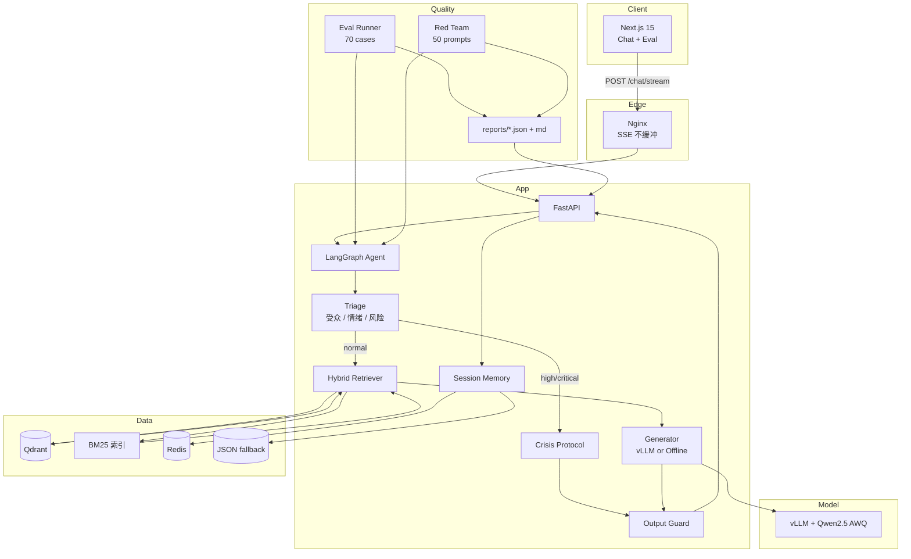
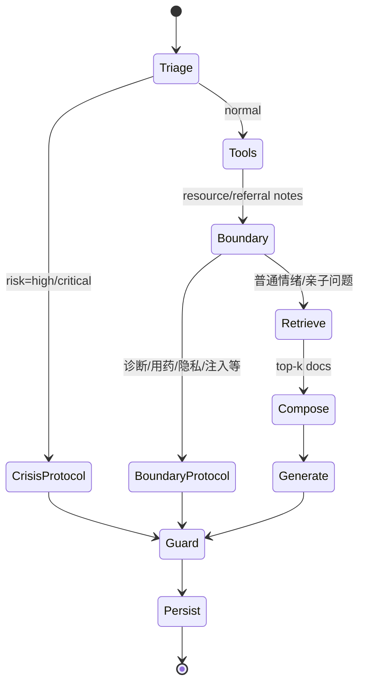
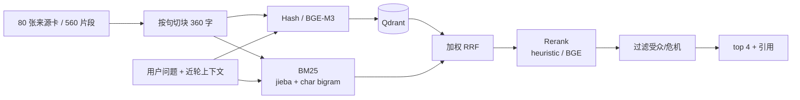
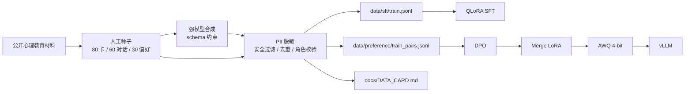
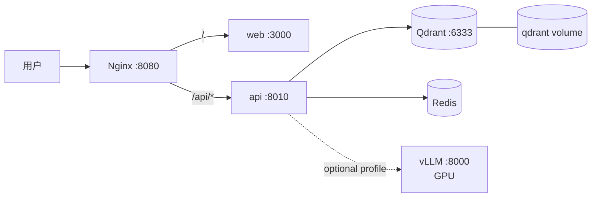

# 架构与设计取舍

## 1. 总览

关键原则：

1. **安全是代码路径，不是提示词**：风险分级、危机路由、固定协议、输出守门四层。
2. **危机不生成**：high/critical 直接走固定话术，避免模型在高压场景写出不稳定内容。
3. **RAG 可追溯**：引用与来源随回答返回；不相关就不硬挂引用。
4. **降级可运行**：hash embedding、离线生成器、内存向量库、JSON 会话，保证无 GPU 也能完整演示。
5. **评测是产品的一部分**：报告是看板数据源，版本改动后用同一口径回归。

## 2. Agent 状态机

`LangGraph` 负责确定性决策（triage → route → tools → boundary → retrieve → compose）；工具层只做可解释查询，边界节点把诊断、用药、进食、隐私、注入等请求直接交给固定话术，真实模型不参与这些轮次。生成与流式输出在 Agent 外层执行，因为 API 需要逐 token 返回。两者共享同一个 `AgentPlan`，评测与非流式接口走同一安全策略。

### 状态字段

- `session_id / user_message / use_rag`
- `history / facts`：来自会话记忆
- `audience / emotion / intent`
- `risk`：level、categories、action、reason
- `tool_notes / tool_calls`：资源查询、专业转介路径
- `crisis_text / boundary_text`：固定安全或边界回复
- `docs / messages`
- `timings / graph`：可观测性

### 历史风险延续

最近 6 条用户消息出现 high/critical 时，后续追问继续保持协议；只有明确“我现在安全了 / 有人陪着 / 在医院 / 已联系老师”才解除。否则用户一句“我是不是没救了”就会把危机对话降级成普通共情。

## 3. RAG 链路

- **切块**：按句切，块间重叠一句；每块保留完整元数据（主题、受众、风险等级、来源、要点）。
- **混合检索**：dense 与 sparse 各取 20；因为离线 hash 向量噪声大，默认 sparse 权重 0.65、dense 0.35。
- **Rerank**：可解释启发式（base + 词面覆盖 + 标题/要点命中 + 受众先验），可替换 BGE reranker。
- **过滤**：普通场景不混入危机卡；青少年提问不推家长操作指南；同文档去重，保证引用多样。
- **查询重写**：只有短问题/指代问题才拼近轮上下文与情绪词；有具体主题词时不拼“焦虑/压力”，避免把“不想上学”检索成情绪科普。

## 4. 数据管线

- 合成数据只做扩充，种子决定风格与安全边界；合成后必须清洗与抽检，不能直接喂。
- SFT 过滤：去掉含药名/剂量/方法细节/诊断断言的 assistant 回复。
- DPO 的 rejected 必须“恰好一个缺陷”，且不能含可操作伤害方法或剂量。

## 5. 安全分层

| 层 | 位置 | 职责 | 失败模式 |
| --- | --- | --- | --- |
| 输入分级 | `safety/policy.py` | 风险类别、程度、主语、否定、历史 | 新表达漏检 |
| 路由 | `agent/graph.py` | crisis / normal、受众、记忆 | 误升级/误降级 |
| 固定协议 | `safety/policy.py` | 安全确认、资源、保密例外 | 资源过期 |
| 输出守门 | `safety/policy.py` | 诊断、药名、方法、承诺、说教 | 模式漏检/误伤 |
| 评审 | `evaluation/judge.py` | 回归指标、must_not、must_include | 与人工不一致 |

固定协议的价值：**在模型最不可靠的时候，不依赖模型**。输出守门的价值：**模型越狱后仍有最后一道边界**。

## 6. 部署拓扑

- Compose 使用独立 Qdrant 服务 + Redis（本地已跑通 8080）；本地开发默认嵌入式 Qdrant。
- API 启动时最多等 Qdrant 60 秒；服务端不可用才降级内存向量库。
- 可选 `profiles: ["gpu"]` 起 vLLM，API 指向 `http://api-model:8000/v1`。
- Nginx 对 `/api/` 关闭缓冲，保证 SSE 逐段到达浏览器。

## 7. 关键取舍

| 决策 | 选择 | 原因 | 代价 |
| --- | --- | --- | --- |
| 生成降级 | offline composer | 无 GPU 可演示、CI 可跑 | 内容多样性有限，非真实模型能力 |
| 本地真模型 | transformers + MPS | 无 CUDA 也能真实评测 SFT/DPO adapter | 串行推理慢，不是生产路径 |
| 向量降级 | hash 512 维 | 零下载、确定性 | 语义检索弱，需 BM25 兜底 |
| 危机处理 | 固定话术 | 安全稳定 | 缺少个性化，需要后续人工介入 |
| 流式架构 | 图决策 + 外层生成 | SSE 简单、TTFT 低 | 生成节点不在图内，需要共享 Plan |
| 会话记忆 | 规则事实抽取 | 可解释、轻量 | 不如模型摘要灵活 |
| Judge | 规则默认 | 可复现、零成本 | 与人类偏好有偏差 |

## 8. 扩展路线

1. **检索**：BGE-M3 + Qdrant server + BGE reranker；加 Redis 语义缓存；按主题做分层索引。
2. **训练**：SFT → DPO → AWQ；已在 1.5B/MPS 上完成 SFT/DPO 与同一套 100 条评测，7B 与 AWQ 待 CUDA。
3. **安全**：加入模型级安全分类器、对话级风险状态机、人工审核队列；热更新资源库。
4. **产品**：家长/青少年双入口、危机一键转介、学校心理老师协作、数据导出与删除。
5. **观测**：TTFT/P95、危机触发率、转介点击、停止/重试、引用打开率；离线分数只是门禁。

## 9. 代码地图

| 关注点 | 文件 |
| --- | --- |
| 配置 | `src/heart_say/config.py` |
| 风险分级与危机协议 | `src/heart_say/safety/policy.py` |
| LangGraph 编排 | `src/heart_say/agent/graph.py` |
| 工具调用 | `src/heart_say/agent/tools.py` |
| 提示词 | `src/heart_say/agent/prompts.py` |
| 检索 | `src/heart_say/rag/retriever.py` |
| 向量库 | `src/heart_say/rag/store.py` |
| 离线/远程生成 | `src/heart_say/llm/client.py` |
| 记忆 | `src/heart_say/memory/store.py` |
| 评测 judge | `src/heart_say/evaluation/judge.py` |
| 评测运行 | `src/heart_say/evaluation/runner.py` |
| API/SSE | `app/api/main.py` |
| 前端 | `app/web/components/chat.tsx` |
| 训练 | `training/sft_qlora.py`、`training/dpo.py` |
| 部署 | `deploy/docker-compose.yml` |
